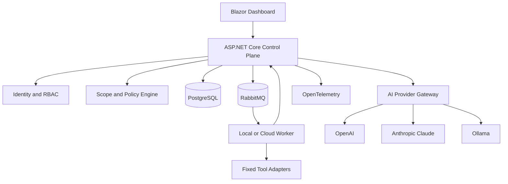
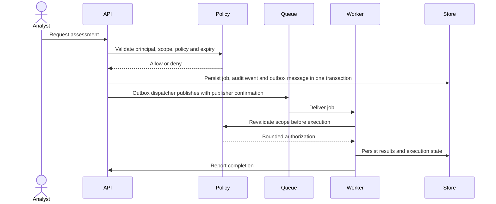

# SentinelAI Architecture

## System context

SentinelAI separates the control plane from the execution plane. A cloud control plane manages identity, target scopes, policies, jobs, findings and reports. A local worker can run inside a private network and establish an outbound authenticated connection, avoiding the need to expose inbound services to that network.

## Logical components

| Component | Responsibility |
|---|---|
| Domain | Tenant, scope, scan policy, job lifecycle, asset, finding, evidence, approval and audit models |
| Application | Use cases, commands/queries, orchestration interfaces and validation |
| Infrastructure | EF Core, PostgreSQL, RabbitMQ, identity and persistence adapters |
| API | Authenticated HTTP entry points, authorization and OpenAPI |
| Web | Blazor dashboard; all data access goes through the authorized API |
| Worker | Consumes bounded jobs and calls fixed tool adapters |
| Security.Policy | Deterministic target and operation authorization |
| Agent.Orchestrator | Plans bounded tasks; the policy engine independently approves each action |
| AI abstractions/providers | Common analysis interface for OpenAI, Claude and Ollama |
| Observability | OpenTelemetry traces, metrics and structured logs |

Phase 2 adds a passive inventory adapter behind the worker’s fixed adapter boundary. It receives only targets that have been revalidated by the scope policy and records offline observations; it does not perform DNS, socket, port or command activity. Asset service observations are persisted with tenant-scoped uniqueness and exposed through authorized reader queries.

## Execution lifecycle

## Design decisions

- Start as a modular monolith for the control plane and a separately deployable worker.
- Use typed scanner adapters; do not expose a generic command-execution API.
- Model AI as an advisory planner and analyst, not an authority.
- Use idempotency keys, bounded retries, cancellation and explicit job state transitions.
- Route jobs through tenant-specific durable queues. Multiple workers may share a tenant queue, but a worker is authenticated and assigned to exactly one tenant.
- Route cancellation messages to the worker identity persisted on the running job; workers also poll persisted cancellation state between target operations.
- Use a transactional outbox so a committed job is eventually published after broker recovery. Duplicate deliveries are safe because execution claims and terminal state are persisted.
- Public target authorization is a separate request/administrator approval workflow and is never created from caller-supplied evidence fields.
- Running jobs carry worker-specific leases with expiry and renewal timestamps. Startup recovery only requeues expired leases; optimistic concurrency prevents two workers from claiming the same queued job.
- Outbox rows carry dispatcher leases, retry timestamps and bounded exponential backoff. PostgreSQL dispatchers claim pending rows with `FOR UPDATE SKIP LOCKED`, while duplicate broker deliveries remain idempotent at the job state machine.
- DNS validation produces a `ValidatedExecutionTarget` containing the approved addresses and expiry; future network adapters must connect only to those addresses while preserving the original hostname for protocol headers/SNI.
- A local worker enables private-network visibility without requiring inbound access.
- Keep AI providers behind a common interface; support model selection and fallback through configuration.

## Deployment modes

**Local:** Compose runs the API, UI, worker, PostgreSQL, RabbitMQ and observability stack on one developer machine or authorized lab host.

**Hybrid/cloud:** the control plane is deployed in a cloud environment; one or more local workers connect outbound using mTLS or short-lived enrollment credentials. Worker-to-control-plane messages are authenticated, authorized, replay-resistant and audited.
